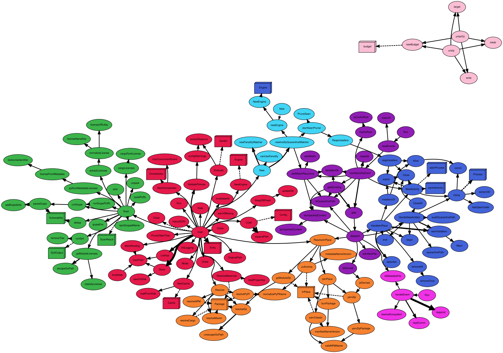

# gated

Supply chain gate daemon. Intercepts package manager installs at the OS level,
scans artifacts with syft/grype/osv-scanner, evaluates OPA policies, and blocks
packages that violate license, vulnerability, or provenance rules.

No wrappers. No symlinks. No devcontainer. One binary, any ecosystem.

## How it works

```
pip install requests
    │
    ▼
 [pip downloads wheel to ~/.cache/uv/...]
    │
    ▼
 [gated intercepts the file operation]
    │
    ├─ verdict cache hit → allow / deny immediately
    │
    └─ cache miss → resolve package identity from path
                  → syft (SBOM + license) + grype + osv-scanner (vulns)
                  → OPA policy evaluation
                  → cache verdict
                  → allow / deny
    │
    ▼
 [pip continues or fails]
```

## Visualisation


The interception mechanism adapts to the platform and available privileges:

| Mode | Platform | Mechanism | Privileges | Guarantee |
|------|----------|-----------|------------|-----------|
| `fanotify` | Linux | Kernel permission events | `CAP_SYS_ADMIN` | Synchronous. Process frozen in kernel space. Zero race window. |
| `quarantine` | Linux, macOS | inotify/FSEvents + atomic rename | None | Near-synchronous. File quarantined before package manager reads it. |

On Linux with `watcher_mode: auto` (default), gated probes for fanotify capability
at startup and falls back to inotify+quarantine transparently. Same binary, same
policies, same scans.

## Quick start

### Developer workstation (no root)

```bash
git clone https://github.com/muratcanozdemir/gated.git
cd gated

# Install scan tools to ~/.local/bin.
./scripts/install-user.sh

# Or build and install manually:
make build
./gated -config configs/config.user.yaml
```

### System-wide (CI runners, shared build machines)

```bash
make build
sudo make install
sudo make install-config
sudo make install-systemd

# Edit watch paths and policy directory.
sudo vim /etc/gated/config.yaml

# Start.
sudo systemctl enable --now gated
sudo journalctl -u gated -f
```

## Build

```bash
make build             # native platform
make build-all         # linux/amd64, linux/arm64, darwin/amd64, darwin/arm64, windows/amd64
make test              # unit tests with race detector
make check             # build + validate policies + vet + policy tests
make policy-test       # opa fmt/check/test on policy/ (same OPA version the daemon embeds)
make snapshot          # GoReleaser dry run into dist/ (this host's OS family)
make tidy              # go mod tidy
```

Version is injected at build time via `-ldflags`:

```bash
./gated -version
# gated 0.3.0 (commit=a1b2c3d, built=2026-05-09T20:00:00Z, linux/amd64)
```

## Releases

Releases are cut by [release-please](https://github.com/googleapis/release-please)
from [Conventional Commits](https://www.conventionalcommits.org/) on `main`: it
keeps a release PR open with the next version and `CHANGELOG.md`; merging it tags
`vX.Y.Z` and creates the GitHub release. `.github/workflows/release.yml` then
builds every platform with [GoReleaser](https://goreleaser.com) (darwin on a macOS
runner, since the FSEvents watcher needs cgo) and attaches to the release:

| Asset | Contents |
|-------|----------|
| `gated_X.Y.Z_OS_ARCH.tar.gz` (`.zip` on Windows) | binary, LICENSE, README, CHANGELOG, example config, systemd units |
| `gated_X.Y.Z_OS_ARCH.cdx.json` | CycloneDX SBOM of the binary |
| `gated-policy_X.Y.Z.tar.gz` | policy bundle: `policy/*.rego` (no tests) + `data.json` |
| `*.provenance.sigstore.json`, `*.sbom.sigstore.json` | SLSA provenance / SBOM attestations |
| `SHA256SUMS` | checksums of the archives, SBOMs and policy bundle |

Verify a download:

```bash
gh attestation verify gated_0.3.0_linux_amd64.tar.gz --repo muratcanozdemir/gated
```

## Configuration

Two example configs are provided:

| File | Use case |
|------|----------|
| `configs/config.example.yaml` | System-wide, fanotify or auto mode |
| `configs/config.user.yaml` | Developer workstation, quarantine mode, everything under `$HOME` |

Key settings:

```yaml
watcher_mode: auto          # auto | fanotify | quarantine
warn_only: true             # log denials but allow everything (rollout mode)
scan_timeout_seconds: 30    # kill scans that hang
```

### Watch paths

Each entry maps a filesystem path to a package ecosystem:

```yaml
watch_paths:
  - path: ~/.cache/uv
    ecosystem: pypi
  - path: ~/go/pkg/mod/cache
    ecosystem: go
  - path: ~/.m2/repository
    ecosystem: maven
  - path: ~/.cargo/registry
    ecosystem: cargo
```

### Ecosystem support

| Ecosystem | Cache artifacts resolved | PURL format |
|-----------|------------------------|-------------|
| PyPI | `.whl`, `.tar.gz` | `pkg:pypi/name@version` |
| Go | `@v/*.zip`, `@v/*.mod` | `pkg:golang/module@version` |
| Maven | `*.jar` | `pkg:maven/group/artifact@version` |
| Cargo | `*.crate` | `pkg:cargo/name@version` |
| npm | `*.tgz` (best-effort) | `pkg:npm/name@version` |

npm's content-addressed cache (`_cacache`) makes path-based resolution unreliable.
For full npm coverage, watch `node_modules/` instead.

## Policies

Policies are OPA Rego files in the `policy/` directory. They share a common
interface: any rule producing a string in `data.gate.deny` causes the package
to be blocked. `common.rego` holds the shared helpers; it reads the scan result
defensively, so a missing or `null` field (e.g. no licenses because syft failed)
can never make a deny rule silently not fire.

### license.rego

Allowlist-based SPDX enforcement, case-insensitive. Packages with blocked
licenses (AGPL, SSPL, BUSL, Elastic-2.0) are denied. Packages with no detected
license are denied (unknown obligation = unacceptable risk). SPDX expressions
are understood: `MIT OR GPL-3.0-only` passes (you may choose MIT),
`MIT AND GPL-3.0-only` does not; with parentheses every identifier must be
approved (conservative).

### vulnerability.rego

Severity-gated with nuance:

- Critical severity: always denied.
- CVSS ≥ 9.0 (`critical_cvss`): denied whatever the scanner's severity label.
- High severity + fix available: denied (upgrade available, no excuse).
- Known exploited (CISA KEV): denied at any severity.
- EPSS ≥ `epss_threshold` (off unless set, e.g. `0.5`): denied as likely to be
  exploited soon.
- More distinct vulnerability IDs than `max_total_vulnerabilities`: denied (a
  CVE reported by both grype and osv-scanner counts once).

Exploitation data is live: grype's vulnerability DB carries CISA KEV and FIRST
EPSS (grype ≥ 0.88; `install-tools.sh` pins 0.122.1), grype refreshes it on its
own, and gated passes it to the policy for each vulnerability, including the CVE
behind a GHSA. There is no CVE list to maintain. `known_exploited_cves` in
`data.json` is only for extra IDs of your own; it is empty by default. Keep the
grype DB fresh: grype refuses to scan with a DB older than 5 days, and a failed
scan fails open (or is denied with `require_clean_scan`).

Accept a vulnerability for a while with a waiver. Every waiver must expire;
expired or undated waivers are ignored and logged as warnings at startup,
on reload and by `gated -validate`:

```json
"vulnerability_waivers": {
  "CVE-2024-0001": {
    "reason": "not reachable: we never parse untrusted YAML (SEC-123)",
    "expires": "2027-01-31",
    "packages": ["pypi/pyyaml"]
  }
}
```

`packages` is optional; without it the waiver applies to every package. A waiver
keyed by a CVE also covers the same vulnerability reported under a GHSA ID.

### provenance.rego

Supply chain origin checks:

- Explicit blocklist of known-malicious packages (`blocked_packages`), either
  every version (`"npm/evil": "reason"`) or only compromised releases
  (`"npm/ua-parser-js": {"reason": "...", "versions": ["0.7.29"]}`).
- Typosquats: a name one edit (insertion, deletion, substitution, adjacent
  swap) away from an entry in `popular_packages` is denied, unless listed in
  `typosquat_allowlist`. Names shorter than `typosquat_min_length` are not
  compared.
- Maven `groupId` namespace allowlist and Go module host prefix allowlist,
  matched on a `.` / `/` boundary (`org.apache` approves `org.apache.commons`,
  not `org.apachex`).
- Optional: deny packages where scan tools errored (`require_clean_scan`).

Names are compared in canonical form: PyPI per PEP 503, npm case-insensitive.

### Testing policies

Each policy has Rego unit tests next to it (`*_test.rego`; the daemon skips
them when loading). `make policy-test` runs `opa fmt`, `opa check --strict` and
`opa test` with a coverage gate, using the OPA version from `go.mod`, so the
tests run on the same engine the daemon embeds.

### Tuning

Edit `policy/data.json` to adjust approved licenses, blocked packages, popular
package lists, namespace rules, extra known-exploited CVEs, vulnerability thresholds (CVSS, EPSS) and
waivers. Every knob has a default in `policy/common.rego`, so a `data.json` from
an older release keeps working. After editing, reload:

```bash
# System service
sudo systemctl reload gated

# User service
systemctl --user reload gated

# Manual
kill -HUP $(pidof gated)
```

SIGHUP re-validates policies and invalidates the verdict cache.

## Deployment

### systemd

Three unit files in `init/systemd/`:

| Unit | Runs as | Mode | Use case | Install |
|------|---------|------|----------|---------|
| `gated.service` | root | fanotify | CI runners, shared machines | `sudo make install-systemd` |
| `gated-unprivileged.service` | `gated` (service user) | quarantine | Server, no root desired | `sudo make install-systemd-unprivileged` (also creates the `gated` system user) |
| `gated-user.service` | your UID | quarantine | Developer workstation | handled by `./scripts/install-user.sh` |

### Distribution via Artifactory

Binary to a generic repo, policies as a separate versioned tarball:

```
internal-tools-generic/
├── gated/
│   ├── v0.3.0/
│   │   ├── gated-linux-amd64
│   │   ├── gated-linux-arm64
│   │   ├── gated-darwin-amd64
│   │   ├── gated-darwin-arm64
│   │   └── config.example.yaml
│   └── latest -> v0.3.0
└── gated-policy/
    └── v0.3.0/
        └── policy.tar.gz
```

Policies change independently of the binary — different cadence, different owners.

## Architecture

```
cmd/gated/main.go          Entry point, wiring, signal handling
internal/
├── config/                 YAML config loader with ~ and $ENV expansion
├── watcher/
│   ├── watcher_iface.go          Watcher interface + Config struct
│   ├── watcher_linux_new.go      Auto-detection: fanotify vs inotify
│   ├── watcher_linux_fanotify.go Kernel-enforced synchronous gate
│   ├── watcher_linux_inotify.go  Unprivileged inotify + quarantine
│   ├── watcher_darwin.go         FSEvents + quarantine (CGo)
│   └── watcher_windows.go        Stub (three strategies documented)
├── quarantine/             Atomic rename gating (cross-platform)
├── resolver/               Path → (ecosystem, name, version) mapping
├── scanner/                Orchestrates syft, grype, osv-scanner
├── policy/                 OPA evaluation engine
└── verdict/                Filesystem-backed verdict cache
```

### Design decisions

**fanotify over eBPF.** fanotify permission events provide synchronous allow/deny
without modifying the target process. eBPF `cgroup/connect4` can intercept
connections but can't block-and-resume a file open.

**Quarantine as universal fallback.** Atomic rename works on every OS and needs no
privileges. The race window (file exists briefly before quarantine) is academic
for package managers — they always close a download before opening for extraction.

**Fail open on errors.** If a scan tool crashes or OPA eval fails, the artifact is
allowed. Logged and recorded in the verdict cache for audit. The daemon never
becomes a single point of failure.

**Filesystem verdict cache.** Zero dependencies. In-memory map for sub-microsecond
hot-path lookups, JSON files on disk for persistence across restarts. 24h
auto-pruning.

**SIGHUP policy reload.** Change policies in production without restart. Verdict
cache is invalidated on reload.

## Scan tools

gated shells out to three tools, all Apache-2.0 licensed. Policy evaluation
(OPA/Rego) runs in-process via the OPA Go SDK — no external `opa` binary
required.

| Tool | Purpose | Project |
|------|---------|---------|
| [syft](https://github.com/anchore/syft) | SBOM generation, license detection | Anchore |
| [grype](https://github.com/anchore/grype) | Vulnerability scanning | Anchore |
| [osv-scanner](https://github.com/google/osv-scanner) | OSV advisory cross-reference | Google |

Install all three with `./scripts/install-tools.sh` (system-wide) or
`./scripts/install-user.sh` (per-user to `~/.local/bin`).

## Limitations

- macOS build requires CGo (`CGO_ENABLED=1`) for CoreServices FSEvents binding.
  Cross-compiling from Linux needs `osxcross` or build natively on a Mac.
- fanotify watches are per-mount, not per-directory (kernel limitation); the daemon
  filters by path prefix in userspace.
- Scan latency adds to install time. Mitigated by pre-scan on file close (fanotify
  `FAN_CLOSE_WRITE`), quarantine during download-to-open gap, and verdict caching.
  First-time installs of large dependency trees will be noticeably slower.
- npm's content-addressed cache is poorly suited to path-based package resolution.
- Windows watcher is a stub. Three implementation strategies are documented in
  `watcher_windows.go` (ReadDirectoryChangesW, minifilter driver, ProjFS).

## License

Apache-2.0. See [LICENSE](LICENSE).
